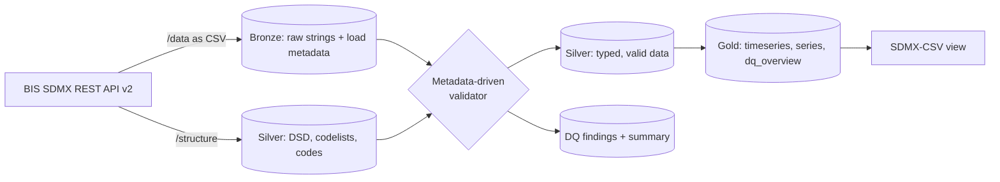

# sdmx-lakehouse-demo

An end-to-end SDMX pipeline on a lakehouse: reads structure metadata from the
[BIS SDMX REST API](https://stats.bis.org/api-doc/v2/), ingests statistical data, validates
it **against its own DSD and codelists**, reports data quality, and publishes SDMX-CSV for
dissemination.

> Independent personal project. Not affiliated with, endorsed by, or produced for the BIS.
> It uses public statistics from the BIS Data Portal purely to demonstrate SDMX on a
> lakehouse. Code only — no BIS data files are stored here.

## The design goal

**Adding a new dataflow is one row of configuration, not new code.**

Every rule, every column order and every output is derived at runtime from the dataflow's
Data Structure Definition, its codelists and a small set of reference tables. Nothing is
hard-coded per dataset.

## Proof

Three dataflows with deliberately different shapes, through the same code:

| | `WS_CBPOL`<br>policy rates | `WS_TC`<br>total credit | `WS_CBTA`<br>central bank assets |
|---|---|---|---|
| Dimensions | 2 | 7 | 6 |
| Mandatory attributes | 5 | 3 | 5 |
| Frequency | monthly | quarterly | monthly |
| Rows in → valid | 408 → 360 | 192 → 192 | 96 → 96 |
| Revisions superseded | 48 | 0 | 0 |
| Series | 5 | 3 | 8 |
| Errors | 0 | 0 | 0 |

`WS_CBTA` was onboarded **after** the framework was finished, by inserting one
`flow_config` row and running `run_flow`. No code was written for it. Its DSD had never
been seen, yet its SDMX-CSV attributes came out in the right order — because that order is
derived from the SDMX attachment hierarchy, not from a per-dataset list.

## Architecture



| Layer | Schema | Contents |
|---|---|---|
| Bronze | `sdmx_bronze` | Raw CSV as all-STRING, plus `source_url`, `ingested_at`, `batch_id` |
| Silver | `sdmx_silver` | Typed, validated data · DQ findings · structure metadata |
| Gold | `sdmx_gold` | `<flow>_timeseries`, `<flow>_series`, `<flow>_sdmx_csv`, `dq_overview` |

## Validation rules

All seven read their parameters from `dsd_components`, `codes` and small reference tables.

| Rule | Checks | Severity |
|---|---|---|
| `STRUCT` | Bronze columns cover every DSD component | error |
| `DIM_CODE` | Each dimension value exists in its codelist | error |
| `ATTR_MANDATORY` | Mandatory attributes are populated | error — but **warning** if empty in 100% of a batch |
| `ATTR_CODE` | Coded attribute values exist in their codelist | error |
| `TIME_FORMAT` | `TIME_PERIOD` matches the pattern for its `FREQ` **and is a real calendar period** | error |
| `OBS_VALUE` | Numeric, or empty with a "missing" `OBS_STATUS` | error |
| `DUPLICATE` | Same key + period twice **within one batch** | error |

The same key and period arriving in a **later** batch is a revision, not a failure: the
latest `ingested_at` wins and superseded rows are counted.

Validation only inspects rows that arrived, so it cannot see a gap. A separate
completeness check compares each expected series against the periods actually received.

## Running it

```
framework/00_bootstrap     once: schemas, volume, reference tables
run_flow                   per dataflow: flow_id, dry_run, fetch
```

`run_flow` chains all five stages. `dry_run=true` computes and reports everything while
writing nothing.

Three regression suites run as Databricks jobs and assert the published figures:
`_regression_v2_1` (12 checks), `_regression_gold` (17), `_regression_completeness` (5).

Unit tests run without Spark:

```bash
pip install pytest && pytest      # 49 cases over the pure-Python rule logic
```

## Repository layout

```
run_flow.py        the driver - the only notebook you run per dataflow
framework/         the six reusable stages, plus three regression suites
notebooks/         Databricks notebooks 00-06 and 99_Decision_Log - how it was built
src/               sdmx_lakehouse/rules.py - pure-Python rule logic, no Spark
tests/             49 pytest cases, including one per seeded error
docs/              SDMX notes, engineering decisions
```

`framework/` and `run_flow.py` are the working pipeline; `notebooks/` is the development
narrative that produced it. The `.py` files are Databricks notebook source - import the
repository into a workspace and the `%run ./framework/...` paths resolve as they stand.

## Status

- [x] Structure and data ingestion, config-driven
- [x] Metadata-driven validation, proven on three dataflows
- [x] Seeded-error test — 6 of 6 injected errors caught, 0 findings on clean controls
- [x] Gold layer and SDMX-CSV export, checked against the BIS API's own output
- [x] Completeness checking
- [ ] Collection simulation — documented, code not reproducible
- [ ] Scheduled job, incremental load

## Limitations

Small data slices, for demonstration — not a production system. `H` (half-yearly) handling
follows SDMX convention but is unverified against BIS data; `W` (weekly) has no parse
expression and raises a warning. Dataset-level attributes are not checked per row. SDMX 2.1
concepts only. Two open issues are recorded in [docs/ENGINEERING.md](docs/ENGINEERING.md).

## More

- **[docs/SDMX.md](docs/SDMX.md)** — what this project demonstrates about SDMX, and where
  each concept appears in the code
- **[docs/ENGINEERING.md](docs/ENGINEERING.md)** — design decisions, testing strategy,
  known issues

## Environment

Databricks Free Edition, serverless · Python 3.12 · Spark 4.2 · Unity Catalog and Delta.
The pipeline calls the BIS REST API directly with `requests`; `sdmx1` and `pysdmx` were
evaluated during exploration but are not dependencies.

## Data source and licence

Statistics: Bank for International Settlements, via the BIS Data Portal API. See the
[BIS terms of use](https://www.bis.org/terms_statistics.htm).

Code licence: Apache 2.0 — see [LICENSE](LICENSE).

Author: **Nikhil Gupta** — [LinkedIn](https://www.linkedin.com/in/nikhil1308).
Views and code are my own.
