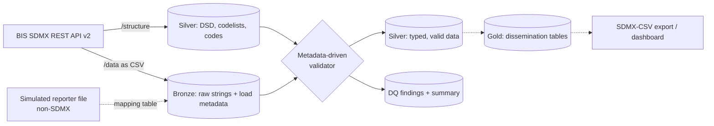

# sdmx-lakehouse-demo

> **Independent personal project. Not affiliated with, endorsed by, or produced for the BIS.**
> It uses public statistics from the BIS Data Portal API purely to learn and demonstrate SDMX on a lakehouse.

A small, end-to-end pipeline on Databricks (Free Edition) that:

1. reads **SDMX structure metadata** (dataflows, DSDs, codelists) from the BIS SDMX REST API,
2. ingests **statistical data** as SDMX-CSV into a Delta lakehouse,
3. **validates the data against its own DSD and codelists**, with rules derived from metadata rather than hard-coded per dataset,
4. reports data quality, and prepares data for dissemination.

The design goal: **adding a new dataflow needs a config row, not new validation code.**

## Why this project

SDMX is the standard for exchanging official statistics. This repo shows hands-on use of its core ideas:

| SDMX concept | Where it appears here |
|---|---|
| Dataflow, DSD (dimensions, attributes, measure) | `dsd_components` table, loaded per flow from the API |
| Codelists and codes (with agency, id, version) | `codelists`, `codes` tables; every code check is tied to its codelist |
| Series key = dimensions + time period | Duplicate and revision logic |
| Mandatory vs conditional attributes | `ATTR_MANDATORY` rule, severity depends on the pattern of missingness |
| `OBS_STATUS` (incl. missing-value codes) | `OBS_VALUE` rule, explicit `obs_status_missing` table |
| Frequency-dependent time periods | `TIME_FORMAT` rule with strict calendar parsing |
| SDMX REST: structure vs data resources, key syntax | Ingestion functions and the findings below |

## Architecture



Solid lines are built; dashed lines are in progress (see [Status](#status)).

## Validation rules

All rules read their parameters from `dsd_components`, `codes` and small reference tables.

| Rule | Checks | Severity |
|---|---|---|
| `STRUCT` | Bronze columns match the DSD components | error |
| `DIM_CODE` | Each dimension value exists in its codelist | error |
| `ATTR_MANDATORY` | Mandatory attributes are present | error if partly missing; **warning** if missing in 100% of a batch (the source never populates it) |
| `ATTR_CODE` | Attribute values exist in their codelist | error |
| `TIME_FORMAT` | `TIME_PERIOD` matches the pattern for `FREQ` **and is a real calendar period** (rejects `2024-13`) | error; warning if no pattern is defined for a `FREQ` |
| `OBS_VALUE` | Numeric, or empty with a "missing" `OBS_STATUS` | error |
| `DUPLICATE` | Same key + period twice **in the same batch** | error |

Repeats of the same key + period **across batches** are treated as revisions, not failures: the latest `ingested_at` wins and superseded rows are counted.

Reference data (not derived from the DSD): `freq_time_patterns` (from SDMX conventions; A, M, Q, D confirmed against real BIS data, H unverified, W has no parse expression yet so it raises a warning), `obs_status_missing` (derived once from the `OBS_STATUS` codelist), and `rule_config` (severity settings).

## Results so far

> Figures are from the latest run; refresh after the final run.

| Flow | Rows in | Superseded | Valid | Errors | Warnings |
|---|---|---|---|---|---|
| `WS_CBPOL` (policy rates) | 408 | 48 | 360 | 0 | 1 batch-level (`TIME_FORMAT` never populated by source) |
| `WS_TC` (total credit) | 192 | 0 | 192 | 0 | 0 |

`WS_TC` has 7 dimensions, 3 mandatory attributes and quarterly data; `WS_CBPOL` has 2 dimensions, 5 mandatory attributes and monthly data. The same validator handled both from metadata alone.

### Seeded-error test

The validator is tested against a table with exactly one injected example of each error type.

| Injected error | Expected rule | Caught |
|---|---|---|
| Invalid `REF_AREA` (`ZZ`) | `DIM_CODE` | Yes |
| Invalid `OBS_STATUS` (`X`) | `ATTR_CODE` | Yes |
| Mandatory attribute empty in some rows | `ATTR_MANDATORY` | Yes |
| `TIME_PERIOD` = `2024-13` | `TIME_FORMAT` | Yes |
| `OBS_VALUE` = `N/A` | `OBS_VALUE` | Yes |
| Duplicate key + period in one batch | `DUPLICATE` | Yes |

The first run caught 4 of 6; after the fixes all 6 are caught. The two misses were (`2024-13` passed a regex-only check; `N/A` raised an error under Spark ANSI mode instead of returning null) were fixed by a strict date parse and `try_cast`. See `notebooks/99_Decision_Log`.

## Things I learned along the way

- **BIS wraps SDMX structure resources.** The standard top-level `/dataflow`, `/datastructure` and `/codelist` resources return HTTP 501; structures are served under `/structure/{type}/{agency}/{id}/{version}`. Data is under `/data/dataflow/{agency}/{flow}/{version}/{key}`.
- **A valid code does not guarantee a series.** `DE` is a valid area code, but Germany has no individual policy-rate series; the euro area series (`XM`) applies.
- **A mandatory attribute can be empty at the source.** `TIME_FORMAT` is mandatory in the DSD but blank in every CSV row, with both `csv` and `sdmx-csv` formats. Treating that as a source-level finding rather than rejecting every row is a deliberate design decision.
- **Syntactically valid is not semantically valid.** `2024-13` matches a month pattern but is not a month.
- **Spark ANSI mode changes casts.** `cast('N/A' as double)` throws; `try_cast` returns null.
- **Seed your own errors.** Zero errors on real data proves little; the seeded test found two real gaps.

## Repository layout

```
notebooks/   Databricks notebooks 00-05, plus 99_Decision_Log
src/         sdmx_lakehouse/rules.py: pure-Python reference rules
tests/       pytest unit tests for the rules
docs/        diagrams and screenshots
```

## Running the tests

```bash
pip install pytest
pytest
```

The unit tests cover the rule logic without Spark. The notebooks run on Databricks Free Edition (serverless); the BIS API must be reachable from your workspace.

## Status

- [x] Structures and data ingestion (config-driven)
- [x] Metadata-driven silver validation, tested on two dataflows
- [x] Seeded-error test and decision log
- [ ] Collection simulation (non-SDMX reporter file mapped to the DSD)
- [ ] Gold tables, SDMX-CSV export, dashboard
- [ ] Scheduled Databricks Job, incremental load demo

## Limitations

- Small data slices, for learning; not a production system.
- `H` time-period handling follows SDMX conventions but is unverified against BIS data; `W` (weekly) has no parse expression yet and raises a warning.
- Attachment level (dataset, series, observation) is read from the DSD; dataset-level attributes are not checked per row. Where a DSD does not state it, observation level is assumed (e.g. `DECIMALS` in `BIS_TOTAL_CREDIT`).
- SDMX 2.1 concepts only; SDMX 3.0 differences are not implemented.

## Data source and licence

Statistics: Bank for International Settlements (BIS), retrieved through the BIS Data Portal API. See the [BIS terms of use for statistics](https://www.bis.org/terms_statistics.htm). **This repository contains code only, not BIS data files.**

Code licence: _TODO: match the licence chosen on GitHub (e.g. MIT)._

Author: _TODO: your name and LinkedIn link._ Views and code are my own.