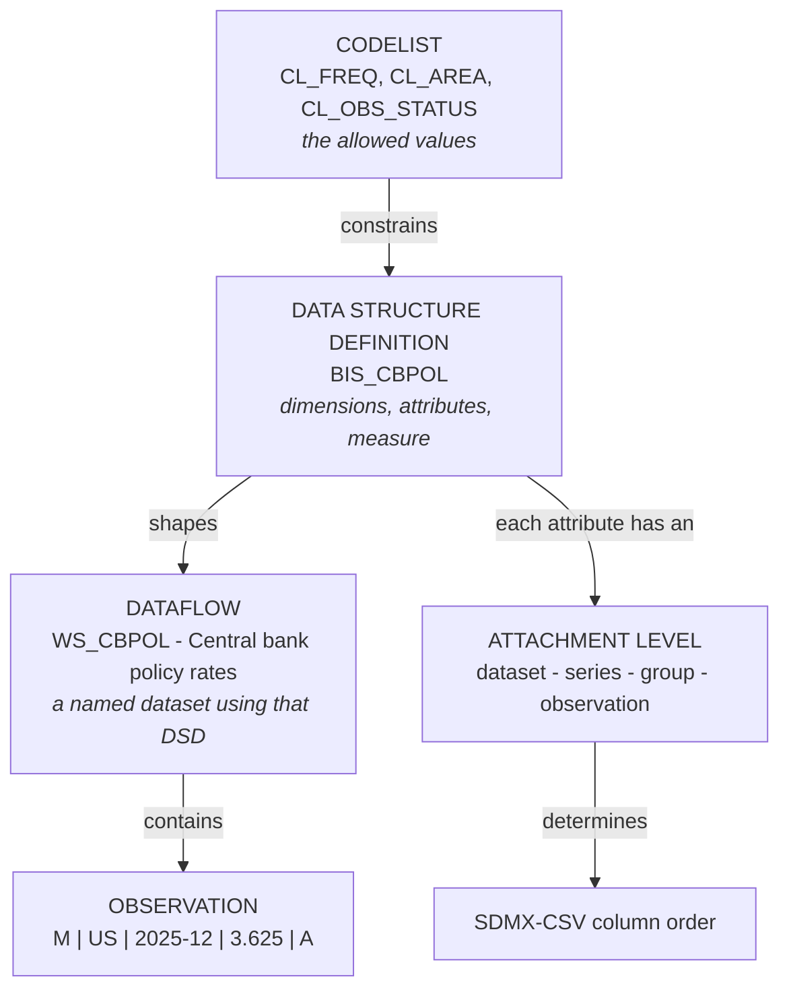
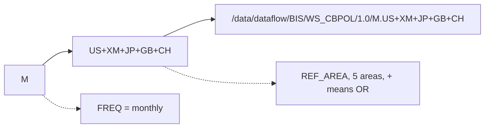
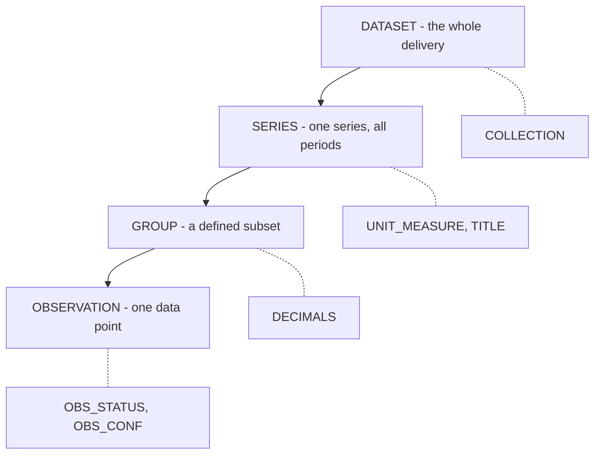
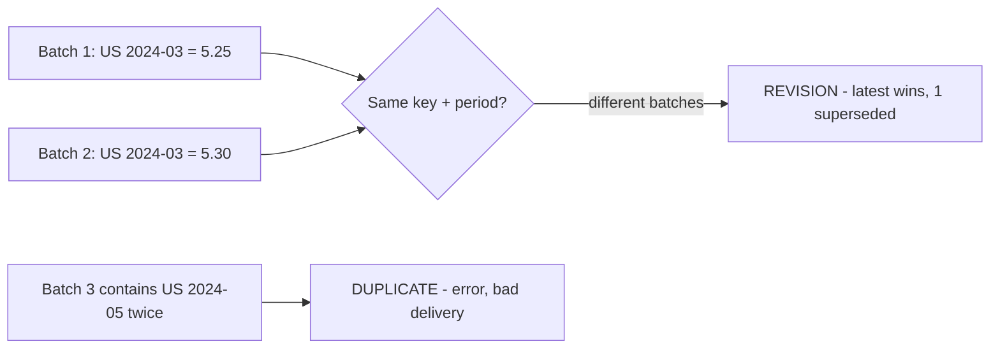
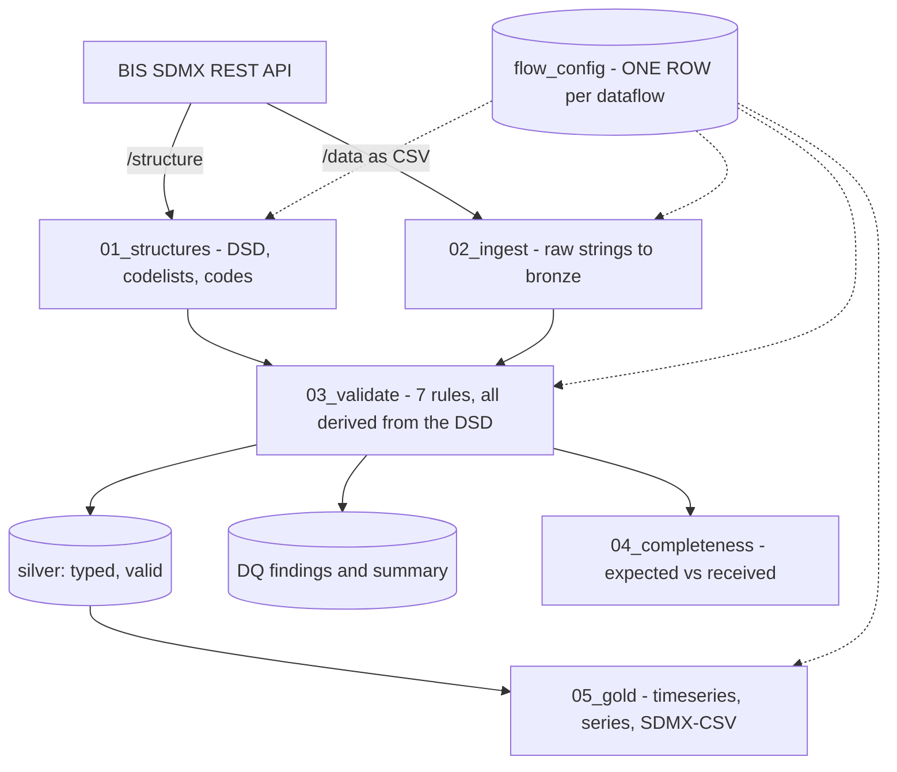

# Understanding SDMX — and this project

A primer. What SDMX actually is, the handful of concepts that matter, and where each one
appears in this pipeline. Every example is real data from the three dataflows here.

---

## The one-sentence version

> **SDMX is a standard for exchanging statistics *together with the metadata needed to
> interpret them*** — so a number never travels without its meaning.

A spreadsheet tells you `3.625`. SDMX tells you: 3.625 per cent, the US central bank policy
rate, monthly, December 2025, a normal observation, published by the BIS, expressed to three
decimal places.

---

## SDMX at a glance



> **Codelists constrain the values. DSDs define the shape. Dataflows hold the data.
> Attachment levels decide the order.**

---

## The three layers, and why people confuse them

| | **Codelist** | **Data Structure Definition** | **Dataflow** |
|---|---|---|---|
| **Answers** | *What values are allowed?* | *What shape is a dataset?* | *Which dataset?* |
| **Is a** | controlled vocabulary | schema | named collection using that schema |
| **Example** | `CL_FREQ`: `A` annual, `M` monthly, `Q` quarterly | `BIS_CBPOL`: 2 dimensions, 11 attributes, 1 measure | `WS_CBPOL` — "Central bank policy rates" |
| **In this repo** | `sdmx_silver.codes` | `sdmx_silver.dsd_components` | `sdmx_bronze.flow_config` |
| **Analogy** | the dropdown options | the table definition | the actual table |

**The trap:** a codelist is identified by **agency + id + version**, never by id alone. Two
versions of `CL_FREQ` in this project disagree — one says `H` means *half-yearly*, the other
says *hourly*. Treating `CL_FREQ` as a single thing silently corrupts data.

---

## Anatomy of one observation

A single row of `WS_CBPOL`:

```
   DIMENSIONS            TIME         MEASURE      ATTRIBUTES
  +--------------+   +----------+   +---------+   +-------------------------+
    FREQ=M  REF_AREA=US   2025-12      3.625       OBS_STATUS=A  DECIMALS=3
  +------+-------+   +----+-----+   +----+----+   +------------+------------+
         |                |              |                     |
   identify WHICH    identify WHEN    the NUMBER         describe it
      series
         +----------------+
          together: the SERIES KEY
```

| Component type | Role | Can it be null? |
|---|---|---|
| **Dimension** | Identifies the series. Always coded. | Never |
| **Time dimension** | Identifies the period within the series | Never |
| **Measure** (`OBS_VALUE`) | The number itself | Only if `OBS_STATUS` explains why |
| **Attribute** | Describes — units, status, confidentiality, titles | Depends on assignment status |

---

## The series key

Dimensions in DSD order, dot-separated. This is how you request data from the REST API.



The three dataflows here have deliberately different shapes — the same code handles all:

| Dataflow | Dims | Key used |
|---|---|---|
| `WS_CBPOL` | 2 | `M.US+XM+JP+GB+CH` |
| `WS_TC` | 7 | `Q.US+DE+JP.H.A.M.770.A` |
| `WS_CBTA` | 6 | `M.US+XM+JP....` |

**An empty position means all values.** `WS_CBTA`'s trailing `....` covers every
`COMP_METHOD`, `UNIT_MEASURE`, `CURRENCY` and `TRANSFORMATION` — a *partial key*. That
returned 8 series without needing to know a single code in those four dimensions.

---

## Attachment levels — the concept most people miss

An attribute does not just describe *a row*. It attaches at a specific level:



Why it matters practically: **this ordering determines SDMX-CSV column order.** It is why
the BIS API's `format=sdmx-csv` and `format=csv` outputs differ.

In `BIS_TOTAL_CREDIT`:

| Attribute | DSD ordinal | Attachment | Sorts |
|---|---|---|---|
| `COLLECTION` | 8 | dataset | **1st** |
| `UNIT_MULT` | 9 | series | 2nd |
| `UNIT_MEASURE` | 10 | series | 3rd |
| `TITLE_TS` | **15** | series | **4th** — jumps forward |
| `DECIMALS` | **11** | group | **5th** — falls back |
| `OBS_STATUS` | 12 | observation | 6th |

Sort by ordinal and you get the wrong answer. Sort by *(attachment level, ordinal)* and you
reproduce exactly what BIS publishes.

---

## `OBS_STATUS`: absent is not the same as zero

An empty `OBS_VALUE` is only acceptable if `OBS_STATUS` explains the absence.

| Code | Meaning |
|---|---|
| `A` | Normal value |
| `H` | Missing — holiday or weekend |
| `L` | Missing — data exist but were not collected |
| `M` | Missing — data cannot exist |
| `Q` | Missing — suppressed |

An empty value with `OBS_STATUS = 'A'` is a contradiction: *normal* and *absent* at once.
This pipeline flags it as an error. The acceptable codes are not hard-coded — they are
derived from `CL_OBS_STATUS` into the `obs_status_missing` table.

---

## Revisions are not duplicates

Statistical data is revised. That is normal, and must not look like a failure.



`WS_CBPOL` here: **408 bronze rows become 360 observations, with 48 superseded.** Those 48
are counted and reported, not silently dropped.

---

## How the pipeline maps to all of this



| Stage | SDMX concept it implements |
|---|---|
| `01_structures` | Fetching DSDs and codelists — the metadata contract |
| `02_ingest` | Data retrieval by series key; bronze stays all-STRING, faithful to source |
| `03_validate` | Codelist membership, assignment status, time format, `OBS_STATUS` semantics |
| `04_completeness` | Expected series — *missing rows*, which row-level validation cannot see |
| `05_gold` | SDMX-CSV dissemination with attachment-level ordering |

---

## The seven validation rules

| Rule | Checks | Derived from |
|---|---|---|
| `STRUCT` | Every DSD component has a column | `dsd_components` |
| `DIM_CODE` | Dimension values exist in their codelist | `codes` |
| `ATTR_MANDATORY` | Mandatory attributes populated | `assignment_status` |
| `ATTR_CODE` | Coded attribute values valid | `codes` |
| `TIME_FORMAT` | Period matches `FREQ` **and is a real calendar period** | `freq_time_patterns` |
| `OBS_VALUE` | Numeric, or empty with a missing-status code | `obs_status_missing` |
| `DUPLICATE` | Same key and period twice in one batch | dimension columns |

**Nothing in that table names a column or a dataset.** That is the design: rules are data.

---

## Worked example: one row, end to end

```
1. flow_config      WS_CBPOL | BIS | 1.0 | BIS_CBPOL | M.US+XM+JP+GB+CH | 2020-01..2025-12
                         |
2. load_structures   ->  DSD BIS_CBPOL: FREQ, REF_AREA, TIME_PERIOD, OBS_VALUE + 11 attrs
                         |  codelists CL_FREQ, CL_AREA, CL_OBS_STATUS ...
3. ingest_flow       ->  bronze: "M","US","2025-12","3.625","A", ...  (all STRING)
                         |
4. validate_flow     ->  FREQ=M         in CL_FREQ                         ok
                         REF_AREA=US    in CL_AREA                         ok
                         2025-12        matches ^\d{4}-\d{2}$ and parses   ok
                         3.625          try_cast to DOUBLE                 ok
                         OBS_STATUS=A   in CL_OBS_STATUS                   ok
                         |
5. silver            ->  M | US | 2025-12 | 2025-12-01 | 3.625 | A
                         |
6. publish_gold      ->  dataflow | BIS:WS_CBPOL(1.0) | I | M | US | 2025-12 | 3.625 | ...
                                    SDMX-CSV, attributes in attachment order
```

---

## Cheat sheet

| Term | Means |
|---|---|
| **DSD** | Data Structure Definition — the schema |
| **Dataflow** | A named dataset using a DSD |
| **Codelist** | Allowed values for a coded component |
| **Series key** | Dimension values identifying one time series |
| **Observation** | One value, at one period, in one series |
| **Attachment level** | Whether an attribute describes the dataset, series, group or observation |
| **Assignment status** | Whether an attribute is Mandatory or Conditional |
| **SDMX-CSV** | Flat exchange format: `STRUCTURE`, `STRUCTURE_ID`, `ACTION`, then components |
| **`STRUCTURE_ID`** | `agency:dataflow(version)` — for example `BIS:WS_CBPOL(1.0)` |

---

## Four things that look obvious and are not

| Assumption | Reality |
|---|---|
| "A valid code means data exists" | `DE` is a valid area code, but Germany has no individual policy-rate series — the euro area `XM` applies |
| "Mandatory means populated" | `TIME_FORMAT` is Mandatory in `BIS_CBPOL` and empty in *every* row BIS returns. Rejecting all 360 rows would be correct and useless |
| "Matching the pattern means valid" | `2024-13` matches `^\d{4}-\d{2}$` and is not a month |
| "A codelist id identifies a codelist" | Identity is agency **plus id plus version**. Two `CL_FREQ` versions here disagree about what `H` means |

Each of those cost real debugging time in this project, and each is now encoded as a rule
or recorded as a documented limitation.
